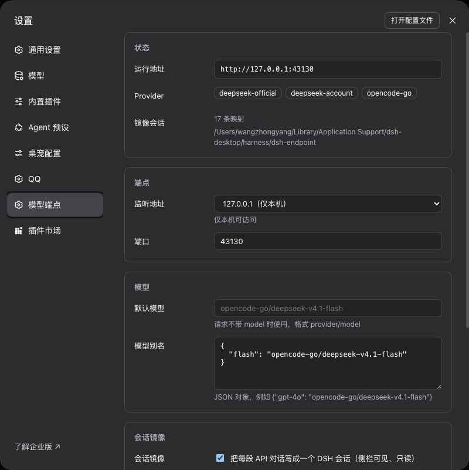

# dsh-endpoint

[](https://www.npmjs.com/package/dsh-endpoint)
[](LICENSE)
[](https://github.com/wangzhongyang/dsh-endpoint/actions/workflows/ci.yml)

Expose the model providers and models already configured in DeepSeek Harness as an
OpenAI-compatible HTTP endpoint.

The endpoint only forwards. It holds no provider credentials and never talks to a
provider directly: every model call goes through `ctx.llm.stream()`, so DSH's provider
adapters (credentials, protocol differences, retries, image handling, token usage) keep
owning the real request.

[中文](README.zh.md)

## Architecture

```
OpenAI-compatible client
   │  POST /v1/chat/completions
   ▼
┌────────────────────── DSH host process ───────────────────────┐
│  dsh-endpoint (Cordis plugin)                                 │
│   HTTP listener → OpenAI mapping → SessionMirror → ctx.llm     │
│                                          │                     │
│                        dsh-llm-pi-ai / dsh-llm-deepseek-*      │
└──────────────────────────────────────────┼─────────────────────┘
                                           ▼
                                   provider API
```

- **Plugin only.** No second process, no second credential store.
- **Sessions are real.** Each conversation is mirrored into a DSH session, so it shows
  up in the sidebar and can be inspected.
- **Read-only mirrors.** The mirrored session holds the persistence write handle, so the
  GUI refuses to resume it (`already owned by an active write handle`).

## Install

Requires DeepSeek Harness Desktop (web profile) 0.2.1-rc.x.

From npm:

```sh
dsh plugin --profile web add dsh-endpoint
```

From a checkout (useful while developing):

```sh
dsh plugin --profile web add /absolute/path/to/dsh-endpoint
```

In the Desktop app you can also use **Settings → Plugins** and install it from the
market once the package is listed.

> **No authentication, no rate limiting.** The endpoint spends your configured
> model quota for anyone who can reach it. Keep it on `127.0.0.1` unless you put
> it behind a proxy you control, and disable the plugin to switch it off.

Restart the app after installing: host plugins are ESM modules, and reinstalling does
not replace the module already loaded in the running process.

## Settings page

**Settings → Model Endpoint** (a custom section, same level as plugin pages).



| Field | Meaning |
|---|---|
| Listen address | `127.0.0.1` (local only) or `0.0.0.0` (all interfaces) |
| Port | default `43130`; the GUI owns `43129` |
| Default model | used when a request omits `model` |
| Model aliases | JSON map, e.g. `{"gpt-4o": "opencode-go/deepseek-v4.1-flash"}` |
| Session mirror | write each API conversation into a DSH session |
| Mapping retention | days an external conversation id keeps its session after last use |
| Workspace directory | workspace that groups mirrored sessions |

Saving applies immediately: **changing the listen address or port rebinds the listener
in place** (the old listener closes, the new one binds, and a failed bind rolls back to
the previous address). Switching `127.0.0.1 ↔ 0.0.0.0` takes the same path. Toggling the
mirror or changing the workspace directory still needs a plugin reload, because those are
built at startup.

In-flight streaming responses are dropped when the listener moves.

The page reads and writes two loopback-only routes: `GET /dsh-endpoint/state` and
`GET|PUT /dsh-endpoint/config`. Saves go to the user layer
`$DSH_HOME/dsh-endpoint/config.json`, which is merged over the plugin config at startup.

## HTTP API

| Method | Path | Notes |
|---|---|---|
| `GET` | `/healthz` | liveness + registered providers |
| `GET` | `/v1/models` | `provider/model` ids plus aliases |
| `GET` | `/v1/models/{id}` | one model |
| `POST` | `/v1/chat/completions` | streaming and non-streaming |

Model ids are `provider/model`, e.g. `opencode-go/deepseek-v4.1-flash`.

**Supported:** `messages` (system/user/assistant/tool), `tools` and `tool_calls`
pass-through, `temperature`, `max_tokens` / `max_completion_tokens`, `stream`,
`stream_options.include_usage`, `stop` (truncated endpoint-side because not every
adapter accepts it).

**Rejected explicitly:** `n > 1`, `tool_choice` other than `"auto"`, remote (`http(s)`) media
URLs, `file_id` references, and binary documents (PDF/DOCX).

## Attachments

Inline base64 only — the endpoint never fetches remote URLs on a client's behalf.

| Input | Handling |
|---|---|
| `image_url` with `data:image/{png,jpeg,webp,gif};base64,…` | decoded → `ctx.attachments.saveImages` → `ImageBlock`; the adapter resizes per route |
| `image_url` with `http(s)://…` | 400: send a data URL instead |
| `file` part with `file_data` of `text/*`, JSON, YAML, XML, JS, SQL | inlined as a `text` block (512 KiB cap, filename preserved) |
| `file` part with a binary document (PDF, DOCX, …) | 400: text extraction is not implemented |
| `file` part with `file_id` | 400: the Files API is not implemented |

Attachments live in DSH's attachment store, so the mirrored session keeps a compact reference
instead of megabytes of base64.

### Limits

| Limit | Value | Source |
|---|---|---|
| Request body | 20 MiB, max 300 MiB | `limits.maxBodyBytes`, a plugin default. DSH's own `/api` limit is 300 MiB (314572800); higher values are rejected |
| One inline text file | 8 MiB, never above the body cap | `limits.maxTextFileBytes`, a plugin default. DSH sets no file-size limit |
| One image | 20 MiB | DSH attachment service (not this plugin) |
| Images per message | 20 | DSH attachment service |
| Total image bytes per message | 200 MiB | DSH attachment service |
| Image pixels / longest side | 64 MP / 8192 px | DSH attachment service |

The text-file cap is a prompt-size guard, not a protocol limit: the body is already
bounded by `maxBodyBytes`, and a file near the cap is far past most models' context
windows. Truncation is announced in the inlined text, so the model knows it is partial.

**Ignored on purpose:** every other unknown field (`top_p`, `seed`, `service_tier`,
`metadata`, …). Real clients send fields this build does not model; rejecting them would
break more than it protects, so they are logged and dropped rather than silently applied.

## Session identity

Resolution order, first hit wins:

1. `x-dsh-session-id` (this plugin's own header)
2. known agent headers: `x-session-id`, `x-conversation-id`, `x-chat-id`, `x-thread-id`,
   `x-agent-session-id`, `x-claude-code-session-id`, `x-codex-session-id`
3. body fields: `session_id`, `conversation_id`, `chat_id`, `thread_id`,
   `metadata.session_id`, `metadata.conversation_id`, `user`
4. content fingerprint: `sha256(model + first user message)` — deterministic across
   requests and restarts
5. only when there is no user message at all, a fresh id is minted

`x-request-id`, `x-correlation-id` and `x-trace-id` are never treated as session ids.

Every response echoes `x-dsh-session-id`. Clients may send it back to pin the
conversation; clients that send nothing still get a stable id from step 4.

Only new user/tool messages are appended to the mirrored session (assistant messages are
always the ones this endpoint produced), so logs grow per turn instead of quadratically.
If the client's user history diverges from what was recorded, a new DSH session is
started and the divergence is logged.

## Supported clients

Any client that can point an OpenAI-compatible provider at a custom base URL:

```bash
export OPENAI_BASE_URL=http://127.0.0.1:43130/v1
export OPENAI_API_KEY=anything          # there is no auth; any placeholder works
```

| Client | How to configure | Status |
|---|---|---|
| `curl` / any HTTP client | POST the body directly | verified |
| OpenAI Python SDK | `OpenAI(base_url="http://127.0.0.1:43130/v1", api_key="any")` | request shape verified |
| OpenAI Node SDK | `new OpenAI({ baseURL: "http://127.0.0.1:43130/v1", apiKey: "any" })` | request shape verified |
| Cline (VS Code) | Provider: OpenAI Compatible → Base URL + any key | expected; not yet end-to-end tested |
| Roo Code (VS Code) | Provider: OpenAI Compatible | expected; not yet end-to-end tested |
| Continue (VS Code / JetBrains) | `provider: openai`, `apiBase: http://127.0.0.1:43130/v1` | expected; not yet end-to-end tested |
| OpenCode (CLI) | custom provider in `opencode.json`, see below | **verified**, tool loop included |
| Cherry Studio | Add provider → OpenAI → API Host | expected |
| Chatbox | Model provider → OpenAI API → API Host | expected |
| LobeChat | OpenAI provider → proxy/base URL | expected |
| Open WebUI | Connections → OpenAI → Base URL | expected |

### OpenCode

Model ids contain a slash, which breaks `provider/model` parsing on the client, so add a
slash-free alias first (Settings → Model Endpoint → Model aliases), e.g.
`{"flash": "opencode-go/deepseek-v4.1-flash"}`. Then point a project `opencode.json` at the
endpoint:

```json
{
  "provider": {
    "dsh": {
      "name": "DSH Endpoint",
      "npm": "@ai-sdk/openai-compatible",
      "options": { "baseURL": "http://127.0.0.1:43130/v1", "apiKey": "anything" },
      "models": { "flash": { "name": "DeepSeek via DSH" } }
    }
  }
}
```

```sh
opencode run -m dsh/flash "list the files here and tell me which is largest"
```

A ready-to-copy file lives at [`examples/opencode.json`](examples/opencode.json).

OpenCode sends `x-session-id`, which the endpoint already treats as the conversation key,
so a whole multi-step tool loop lands in one mirrored session.

Tool calls are forwarded both ways (`tools` in, `tool_calls` out); OpenCode's shell/read
tool loop has been verified end to end.

## Limitations

- No authentication and no rate limiting. The stop switch is disabling the plugin. Keep
  it on `127.0.0.1`; binding `0.0.0.0` lets anyone who can reach the port spend your quota.
- Inline images and text files only; remote media URLs and binary documents are refused.
- `n > 1`, `tool_choice` other than `auto`, `logprobs`, `top_p`, `seed` are not applied.
- Mirrored sessions cannot be continued in the GUI by design.
- Pinned to DSH internal packages (`0.2.1-rc.x`); API changes there can break this plugin.

## Development

```sh
pnpm install
node --test                              # 47 cases, no DSH required
node spike/mock-provider.mjs 44001       # local fake provider
```

`spike/` also contains the P0 harness that creates a session in a throwaway `DSH_HOME`,
persists it, restores it, and checks that GUI takeover is refused (`spike/run.sh`).

## Verified / not verified

Verified on a real Desktop install:

- `/v1/models` (31 models across `opencode-go`, `deepseek-official`, `deepseek-account`)
- non-streaming and streaming chat with usage
- the same conversation twice → the same `x-dsh-session-id`
- mirrored session persists with `turn/start → step/start → user → assistant → step/end →
  turn/end`, second turn appends only the new user message
- mirrored sessions appear in the sidebar workspace
- `agentLoop.resume` refused while the write handle is held
- settings page: section registered, config read/write round-trip
- live listener rebind (`43130 → 43131 → 43130`) without restarting the app
- inline image input (a 1152×883 screenshot was described correctly)
- OpenCode driving a full tool loop (two shell calls in one turn, mirrored with tool results)

Not verified yet:

- other IDE agents (Cline, Roo Code, Continue)
- multiple concurrent conversations against one provider quota
