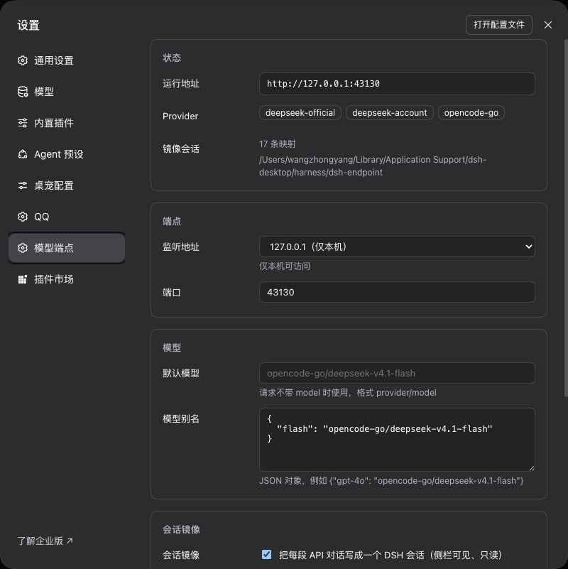

# dsh-endpoint

把 DeepSeek Harness 里已经配置好的模型供应商和模型，暴露成一个 OpenAI 兼容的 HTTP 端点。

端点只负责转发：它不持有任何 provider 凭据，也不直接访问三方 API。每一次模型调用都走
`ctx.llm.stream()`，凭据、协议差异、重试、图片处理、用量统计仍然由 DSH 的 provider 适配器负责。

[English](README.md)

## 架构

```
OpenAI 兼容客户端
   │  POST /v1/chat/completions
   ▼
┌────────────────────── DSH Host 进程 ──────────────────────────┐
│  dsh-endpoint（Cordis 插件）                                   │
│   HTTP listener → OpenAI 映射 → SessionMirror → ctx.llm        │
│                                          │                     │
│                        dsh-llm-pi-ai / dsh-llm-deepseek-*      │
└──────────────────────────────────────────┼─────────────────────┘
                                           ▼
                                      三方模型 API
```

- **只做插件**：没有第二个进程，也没有第二套凭据。
- **会话是真的**：每段对话镜像成一条 DSH 会话，侧栏可见、可查看。
- **镜像只读**：镜像会话持有持久化写句柄，GUI 里点「继续」会被拒
  （`already owned by an active write handle`）。

## 安装

需要 DeepSeek Harness Desktop（web profile）0.2.1-rc.x。

从 npm 安装：

```sh
dsh plugin --profile web add dsh-endpoint
```

从源码目录安装（开发时用）：

```sh
dsh plugin --profile web add /absolute/path/to/dsh-endpoint
```

在 Desktop 里也可以走 **设置 → 插件**，等包进入市场后直接搜 `dsh-endpoint`。

> **没有鉴权、没有限流。** 谁能连上这个端口，就能花你配置的模型额度。除非前面有你自己
> 控制的反向代理，否则请保持在 `127.0.0.1`；停用插件就是关闭它。

安装后要重启应用：宿主插件是 ESM 模块，重装只换磁盘快照，不换已经加载进进程的模块。

## 设置页

**设置 → 模型端点**（自定义分区，和插件页同级）。



| 字段 | 含义 |
|---|---|
| 监听地址 | `127.0.0.1`（仅本机）或 `0.0.0.0`（所有网卡） |
| 端口 | 默认 `43130`；GUI 占用 `43129` |
| 默认模型 | 请求不带 `model` 时使用 |
| 模型别名 | JSON 映射，例如 `{"gpt-4o": "opencode-go/deepseek-v4.1-flash"}` |
| 会话镜像 | 把每段 API 对话写成一条 DSH 会话 |
| 映射保留 | 外部会话 ID 超过多少天没再用就解绑 |
| 工作区目录 | 镜像会话归属的 workspace |

保存即时生效：**改监听地址或端口会就地重绑 listener**（先关旧的、再绑新的，绑定失败回滚到
原地址）。`127.0.0.1 ↔ 0.0.0.0` 走同一条路径。切换镜像开关、改工作区目录仍然需要重载插件，
因为它们在启动时构建。

重绑时正在进行的流式响应会断开。

页面通过两条 loopback 路由读写：`GET /dsh-endpoint/state`、`GET|PUT /dsh-endpoint/config`。
保存写入用户层 `$DSH_HOME/dsh-endpoint/config.json`，启动时叠加在插件 config 之上。

## HTTP 接口

| 方法 | 路径 | 说明 |
|---|---|---|
| `GET` | `/healthz` | 存活 + 已注册 provider |
| `GET` | `/v1/models` | `provider/model` 列表 + 别名 |
| `GET` | `/v1/models/{id}` | 单个模型 |
| `POST` | `/v1/chat/completions` | 流式与非流式 |

模型名为 `provider/model`，例如 `opencode-go/deepseek-v4.1-flash`。

**支持**：`messages`（system/user/assistant/tool）、`tools` 与 `tool_calls` 透传、
`temperature`、`max_tokens` / `max_completion_tokens`、`stream`、
`stream_options.include_usage`、`stop`（端侧截断，因为不是所有适配器都接受它）。

**明确拒绝**：`n > 1`、`tool_choice` 非 `"auto"`、远程（`http(s)`）媒体 URL、`file_id`
引用、二进制文档（PDF/DOCX）。

## 附件

只接受内联 base64——端点不会代替客户端去下载远程地址。

| 输入 | 处理 |
|---|---|
| `image_url` + `data:image/{png,jpeg,webp,gif};base64,…` | 解码 → `ctx.attachments.saveImages` → `ImageBlock`，由适配器按路由缩放 |
| `image_url` + `http(s)://…` | 400，要求改用 data URL |
| `file` 部件的 `file_data` 为 `text/*`、JSON、YAML、XML、JS、SQL | 直接内联成 `text` 块（上限 512 KiB，保留文件名） |
| `file` 部件为二进制文档（PDF、DOCX 等） | 400，未实现文本抽取 |
| `file` 部件用 `file_id` | 400，未实现 Files API |

附件存放在 DSH 的附件库里，所以镜像会话只保留一个紧凑引用，而不是几 MB 的 base64。

**故意忽略**：其余未知字段（`top_p`、`seed`、`service_tier`、`metadata` …）。真实客户端
会发一堆本版本没有建模的字段，严格拒绝会破坏更多东西，所以记录日志后丢弃，而不是假装生效。

## 会话身份

解析顺序，先命中先用：

1. `x-dsh-session-id`（本插件自己的头）
2. 已知 agent 会话头：`x-session-id`、`x-conversation-id`、`x-chat-id`、`x-thread-id`、
   `x-agent-session-id`、`x-claude-code-session-id`、`x-codex-session-id`
3. body 字段：`session_id`、`conversation_id`、`chat_id`、`thread_id`、
   `metadata.session_id`、`metadata.conversation_id`、`user`
4. 内容指纹：`sha256(model + 首条 user 消息)`——跨请求、跨重启都是确定值
5. 只有在完全没有 user 消息时，才新生成

`x-request-id`、`x-correlation-id`、`x-trace-id` 永远不会被当成会话 ID。

每个响应都回写 `x-dsh-session-id`。客户端回传即可锁定这段对话；什么都不发的客户端也能靠
第 4 条拿到稳定 ID。

镜像只追加新的 user / tool 消息（assistant 消息永远由本端点自己的流产生），所以日志按轮次
线性增长，不会二次膨胀。如果客户端的 user 历史与记录的前缀不一致，会新开一条 DSH 会话并记日志。

## 支持的客户端

任何能把 OpenAI 兼容 provider 指向自定义 base URL 的客户端：

```bash
export OPENAI_BASE_URL=http://127.0.0.1:43130/v1
export OPENAI_API_KEY=anything          # 没有鉴权，随便填占位符
```

| 客户端 | 配置方式 | 状态 |
|---|---|---|
| `curl` / 任意 HTTP 客户端 | 直接 POST | 已验证 |
| OpenAI Python SDK | `OpenAI(base_url=..., api_key="any")` | 请求形态已验证 |
| OpenAI Node SDK | `new OpenAI({ baseURL: ..., apiKey: "any" })` | 请求形态已验证 |
| Cline（VS Code） | Provider: OpenAI Compatible → Base URL + 任意 key | 理论上可用，未端到端验证 |
| Roo Code（VS Code） | Provider: OpenAI Compatible | 理论上可用，未端到端验证 |
| Continue（VS Code / JetBrains） | `provider: openai`、`apiBase: http://127.0.0.1:43130/v1` | 理论上可用，未端到端验证 |
| OpenCode（CLI） | 在 `opencode.json` 里加自定义 provider，见下 | **已验证**，含工具循环 |
| Cherry Studio | 添加供应商 → OpenAI → API Host | 理论上可用 |
| Chatbox | 模型供应商 → OpenAI API → API Host | 理论上可用 |
| LobeChat | OpenAI provider → 代理/base URL | 理论上可用 |
| Open WebUI | 连接 → OpenAI → Base URL | 理论上可用 |

### OpenCode

模型 id 里带斜杠，会破坏客户端的 `provider/model` 解析，所以先在设置页加一个无斜杠别名
（模型别名），例如 `{"flash": "opencode-go/deepseek-v4.1-flash"}`，再在项目里放一个
`opencode.json`：

```json
{
  "provider": {
    "dsh": {
      "name": "DSH Endpoint",
      "npm": "@ai-sdk/openai-compatible",
      "options": { "baseURL": "http://127.0.0.1:43130/v1", "apiKey": "anything" },
      "models": { "flash": { "name": "DeepSeek via DSH" } }
    }
  }
}
```

```sh
opencode run -m dsh/flash "列出当前目录的文件，告诉我哪个最大"
```

可直接复制的文件在 [`examples/opencode.json`](examples/opencode.json)。

OpenCode 会发 `x-session-id`，端点本来就把它当会话键，所以整个多步工具循环会落进同一条镜像会话。

工具调用双向透传（进来 `tools`，出去 `tool_calls`）；OpenCode 的 shell/read 工具循环已端到端验证。

## 限制

- 没有鉴权、没有限流。停止开关就是停用插件。请保持在 `127.0.0.1`；绑 `0.0.0.0`
  意味着同网段任何人都能花你的额度。
- 只支持内联图片与文本文件；远程媒体 URL 和二进制文档会被拒绝。
- `n > 1`、`tool_choice` 非 `auto`、`logprobs`、`top_p`、`seed` 都不会生效。
- 镜像会话按设计不能在 GUI 里继续对话。
- 绑定 DSH 内部包（`0.2.1-rc.x`），那边接口变化可能导致本插件失效。

## 开发

```sh
pnpm install
node --test                              # 47 个用例，不需要 DSH
node spike/mock-provider.mjs 44001       # 本地假 provider
```

`spike/` 里还有 P0 验证脚本：在临时 `DSH_HOME` 里创建会话、落盘、恢复，并验证 GUI 接管被拒
（`spike/run.sh`）。

## 已验证 / 未验证

在真实 Desktop 安装上验证过：

- `/v1/models`（`opencode-go`、`deepseek-official`、`deepseek-account` 共 31 个模型）
- 非流式与流式对话，含 usage
- 同一对话两次请求 → 同一个 `x-dsh-session-id`
- 镜像会话落盘为 `turn/start → step/start → user → assistant → step/end → turn/end`，
  第二轮只追加新的 user 消息
- 镜像会话出现在侧栏 workspace
- 持有写句柄时 `agentLoop.resume` 被拒
- 设置页：分区已注册、配置读写往返
- 在线重绑监听地址（`43130 → 43131 → 43130`），不用重启应用
- 内联图片（1152×883 截图被正确描述）
- OpenCode 的完整工具循环（一轮两个 shell 调用，连工具结果一起镜像）

尚未验证：

- 其它 IDE agent（Cline、Roo Code、Continue）
- 同一 provider 额度下的多会话并发
